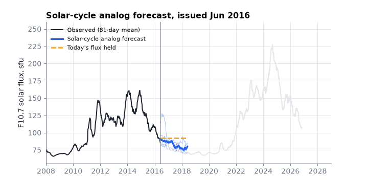

# SOLACE

**Solar-cycle-Aware Lifetime And Conformal Estimation.** It forecasts when debris and rocket
bodies re-enter, with calibrated windows, under solar-cycle uncertainty. Around that core it
does debris conjunction screening and hypervelocity impact physics, and runs a live sky tracker.

## Re-entry forecasting: the core result

Each object gets a ballistic coefficient fitted from its own orbital decay. It is then
propagated through NRLMSIS 2.0 density with J2 and Sun/Moon perturbations, under a forecast of
the solar cycle. This was tested on 135 forecast dates from 2016 to 2026 (326k forecasts,
39,814 re-entries), using only data available on each date.

<p align="center"></p>

| | |
|---|---|
|  |  |
| Earlier solar cycles are read forward from today's phase and rescaled to today's flux. | Holding today's flux fails when the cycle turns: 57 % error in 2021, against 15 % with the cycle forecast. |

<p align="center"></p>

For highly eccentric orbits (GTO, Molniya), the Sun and Moon pull perigee down into the
atmosphere. Above is a Soviet SL-6 upper stage with a 40,000 km apogee. Without the Sun and Moon
it never re-enters; with them it re-enters 27 days before the real date (April 2025). Across all
e ≥ 0.2 objects, the error falls from 34 % to 16 %.

| | |
|---|---|
|  |  |
| Sun/Moon perturbations only matter for eccentric orbits. | Online-calibrated 80 % windows: 77 % coverage over the decade, but 56 % in 2025 after the Cycle 25 maximum. |

The physics, methods and every negative result are written up in [docs/PHYSICS.md](docs/PHYSICS.md).

## Also in the box

| | |
|---|---|
|  | **Hypervelocity impact.** A 2-D SPH hydrocode (Mie–Grüneisen equation of state) and Whipple-shield ballistic limit equations. Shock pressure matches the exact Hugoniot to 1.3 %, and the debris-cloud half-angle is ~38° (30–45° in experiments). |

- **Live Sky** web app: a satellite & debris globe, a near-Earth asteroid tracker with MOID, and a planets & stars sky view.
- **Catalog**: the full public catalog (~33k objects, ~12k debris and rocket bodies) via COMSPOC Spacebook, with CelesTrak as the fallback.
- **Conjunctions**: batch SGP4 over the public catalog → time of closest approach (TCA), miss distance, collision probability (2-D Foster Pc), with realistic Spacebook covariances.
- **Risk**: an orbital-shell graph, an SGP4 physics baseline, a spatio-temporal GNN forecaster, and a per-asset penetration-risk index.

See [PLAN.md](PLAN.md) for the design, data sources and research plan. Figures are rebuilt with
`scripts/make_figures.py`, and app captures with `scripts/capture_app.py`.

## Install

```bash
python3 -m venv .venv
.venv/bin/pip install -e ".[dev,ml,live]"
```

## Use

```bash
.venv/bin/solace screen NISAR --days 3
.venv/bin/solace risk NISAR --days 365 --area 100
.venv/bin/solace impact --speed 7 --sph --html reports/whipple_7kms.html
.venv/bin/solace validate
.venv/bin/solace serve
```

`serve` starts the Live Sky app at http://127.0.0.1:8000.

A full walkthrough with figures is in [notebooks/walkthrough.ipynb](notebooks/walkthrough.ipynb). It covers screening NISAR, assumed vs Spacebook covariance, ballistic-limit curves, an SPH impact, the shell grid, asset exposure, and MOID vs JPL. Rebuild it with `.venv/bin/python notebooks/build_walkthrough.py`.

## Deploy the Live Sky demo

```bash
docker build -t solace .
docker run -p 8000:8000 solace
```

To host it, push the repo to GitHub, then in Render go to New → Blueprint and select the repo; it reads [render.yaml](render.yaml). Measured in Docker with the full catalog, the server uses about 430 MiB (399 MiB peak during startup). That fits the free 512 MB plan with little headroom, so use the Starter plan if Render restarts it for memory. Free instances sleep when idle, and the first visit afterwards takes several minutes while the catalog reloads and the protected assets are re-screened.

## Development

```bash
.venv/bin/ruff check src tests
.venv/bin/pytest -q
```

CI ([.github/workflows/ci.yml](.github/workflows/ci.yml)) runs lint and the offline unit tests on Python 3.10–3.12.

Training the forecaster uses historical catalog snapshots. By default they come from COMSPOC Spacebook, which needs no account (about 1.6 GB for weekly snapshots 2016–2026):

```bash
.venv/bin/solace history --start 2016-01-04 --end 2026-10-26 --step 7
.venv/bin/python scripts/run_phase3.py --seeds 2 --epochs 150
```

Space-Track (`--source spacetrack`, with `SPACETRACK_USER` / `SPACETRACK_PASS` set) is optional.

## Validation so far

| Check | Result |
|---|---|
| Pc vs closed-form (isotropic, noncentral χ²) | matches to 1e-4 relative |
| Screening vs CelesTrak SOCRATES (100 events) | 81 reproduced; TCA within 0.9 s median; relative speed within 0.4 m/s; range differs by a median of 5 km. SOCRATES used TLEs 14–45 h older, so this is TLE-update error, not engine error |
| SPH vs exact shock Hugoniot (Al on Al, 1–4 km/s) | shock pressure within 1.3 %, particle velocity exact |
| SPH vs BLE | the BLE limit for a 0.5/1.5 mm shield at 15 mm standoff, 7 km/s, is 1.95 mm; SPH shows a 2 mm particle perforating |
| Debris cloud half-angle (SPH) | ~38°, within the 30–45° seen experimentally |
| MOID vs JPL SBDB (60 PHAs) | median difference 1.2e-4 au, max 8.8e-4 au |
| Spacebook ephemeris vs our SGP4 (NISAR) | 43 m at epoch, so its covariance describes exactly the propagation we use |
| Assumed vs Spacebook covariance (455 events, 6 assets) | Spearman 0.43; 38 alert-tier changes; events above 1e-6 fall from 32 to 10; Starlink Pc systematically higher (manoeuvre-driven TLE error), debris mixed |

## Known limitations

- TLEs carry no covariance. Pc uses COMSPOC Spacebook synthetic covariance where available, and assumed RIC sigmas otherwise. Each event records which source it used.
- The SPH solver is 2-D planar and hydrodynamic only (no strength). It's good for cloud shape and timing, but not for exact rear-wall failure.
- The kinetic-gas conjunction rate assumes random motion. It badly overestimates rates inside coordinated constellation shells (Starlink), so the forecaster will be trained against real CDM labels.
- The small-debris power-law slopes in the risk index are defaults that still need calibrating against returned-surface impact data.
- On 2016–2026 history the GNN ties a hybrid physics forecast of 28-day total shell populations. On debris-cohort decay it beats SGP4 physics by 11–14 % at 3 and 6 months, but space-weather inputs add nothing at any target tried, and its re-entry counts are far worse than physics (see PLAN §7).
- Per-object re-entry (Phase 3c): physics with fitted ballistic coefficients, Sun/Moon perturbations and a solar-cycle analog forecast reaches an 18 % median 1-year timing error over 2016–2026 (persistence 22 %, SGP4 200 %; 12 % given the true future space weather). Calibrated 80 % windows cover 77 % over the decade but only 56 % in 2025, after the Cycle 25 maximum. Learned residuals don't generalise across the solar cycle. Theory and choices are in [docs/PHYSICS.md](docs/PHYSICS.md).
