# SOLACE

**Solar-cycle-Aware Lifetime And Conformal Estimation.** It forecasts when debris and rocket
bodies re-enter, with calibrated windows, under solar-cycle uncertainty. Around that core it
does debris conjunction screening and hypervelocity impact physics, and runs a live sky tracker.

<p align="center">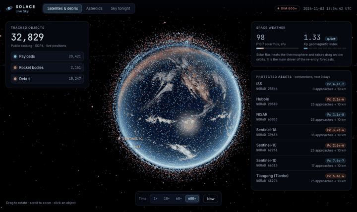</p>

## Re-entry forecasting: the core result

Each object gets a ballistic coefficient fitted from its own orbital decay. It is then
propagated through NRLMSIS 2.1 density with J2 and Sun/Moon perturbations, under a forecast of
the solar cycle. This was tested on 135 forecast dates from 2016 to 2026 (326k forecasts,
39,814 re-entries), using only data available on each date.

<p align="center">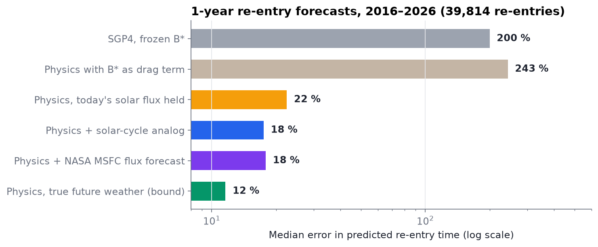</p>

| | |
|---|---|
|  | 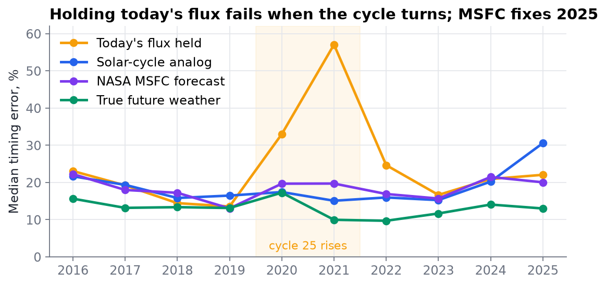 |
| Earlier solar cycles are read forward from today's phase and rescaled to today's flux. | Holding today's flux fails when the cycle turns (57 % in 2021). NASA MSFC's archived forecasts, used as issued, fix the analog's 2025 miss (31 % → 20 %). |

<p align="center">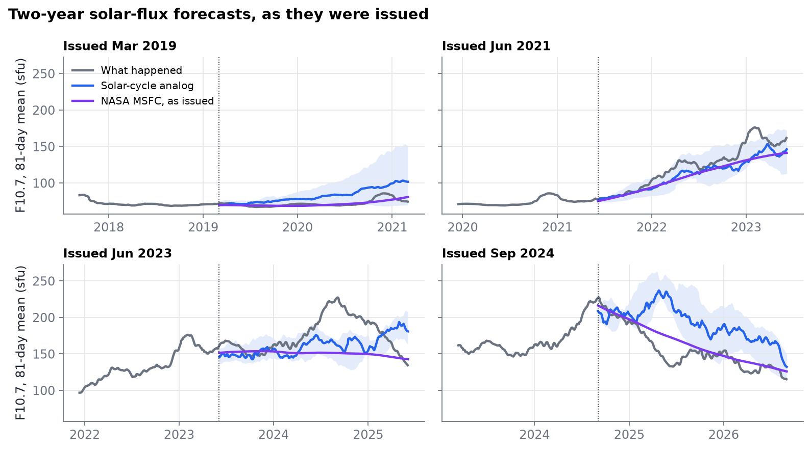</p>

After the Cycle 25 maximum, the analog expected a second peak that never came; MSFC's forecast
followed the decline. Over the 2023–26 test years, physics driven by MSFC's forecast has an 18 %
median 1-year error and re-entry count error of 47 per date (analog: 20 %, 61).

<p align="center">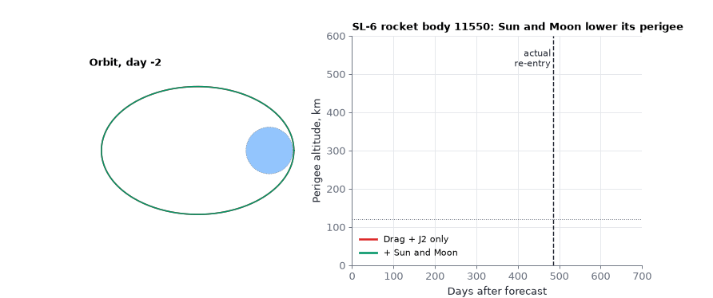</p>

For highly eccentric orbits (GTO, Molniya), the Sun and Moon pull perigee down into the
atmosphere. Above is a Soviet SL-6 upper stage with a 40,000 km apogee. Without the Sun and Moon
it never re-enters; with them it re-enters 27 days before the real date (April 2025). Across all
e ≥ 0.2 objects, the error falls from 34 % to 16 %.

| | |
|---|---|
| 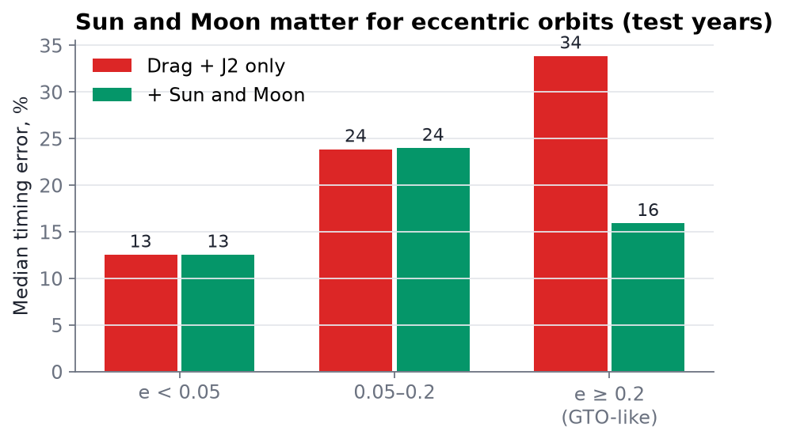 | 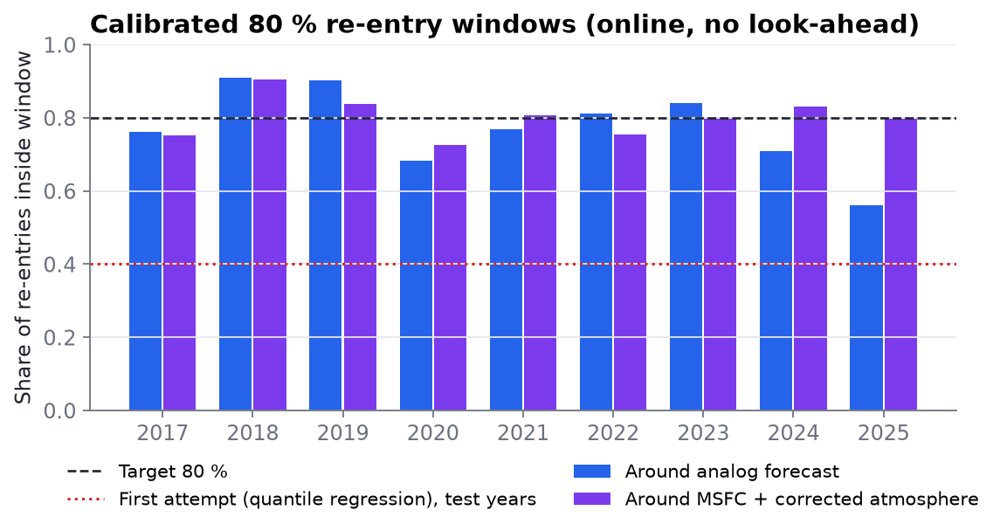 |
| Sun/Moon perturbations only matter for eccentric orbits. | Online-calibrated 80 % windows. Around the analog they fall to 56 % in 2025; around MSFC on a density-corrected atmosphere every year is 73–90 % (81 % on test years). |

The physics, methods and every negative result are written up in [docs/PHYSICS.md](docs/PHYSICS.md); the impact model and its validation in [docs/IMPACT.md](docs/IMPACT.md).

## Live Sky

The web app (three.js, `solace serve`) shows the whole public catalogue live in an inertial frame:
the Earth turns under it at true sidereal rate, at up to 600× speed.

| | |
|---|---|
| 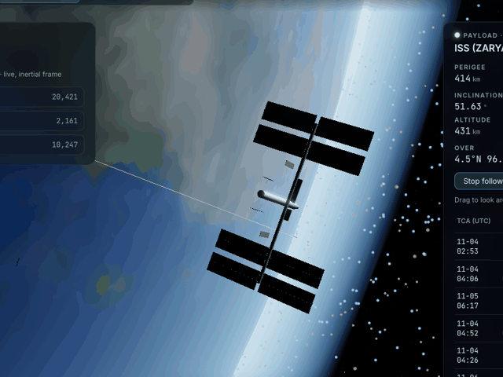 | **Ride along with any object.** Zoom from the whole catalogue down to a single spacecraft. Near the camera, objects become 3-D models (satellites, rocket bodies, tumbling debris; detailed ISS and Hubble), dark when they are in Earth's shadow. Double-click any object to follow it in its own orbital frame, with live altitude, speed, ground position and lighting. |
| 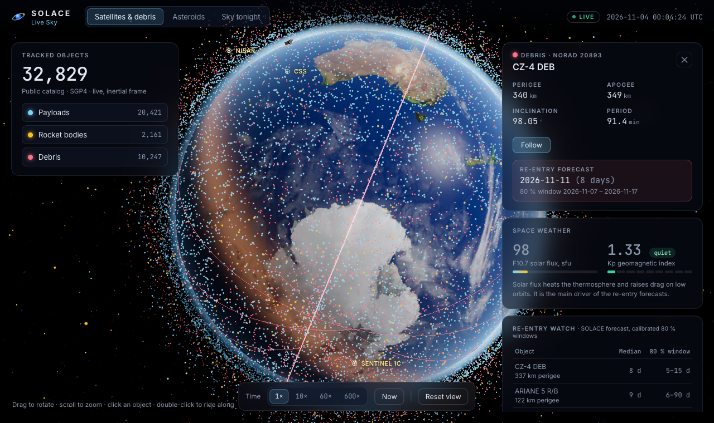 | **Re-entry watch.** The paper's forecast, issued daily on today's catalogue (`scripts/reentry_watch.py`): fitted drag, density-corrected NRLMSIS, NASA MSFC flux forecast, and 80 % windows calibrated on the 2016–2026 hindcast of the same method. Click an object for its date, window and ground track. |
| 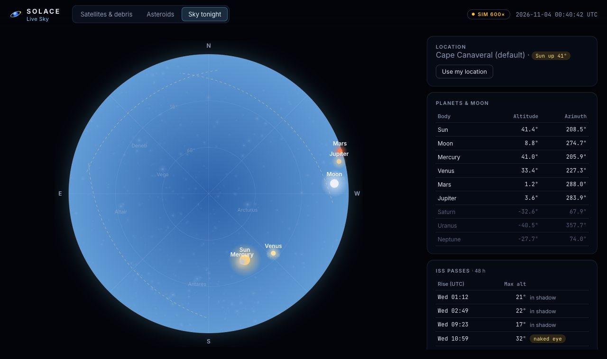 | **Sky tonight.** The sky from your location, first-person: stars, constellations, planets, the Moon's phase, ISS passes, and every tracked satellite above your horizon right now, drawn bright when sunlit and dim in Earth's shadow, with naked-eye candidates listed. |

## Also in the box

| | |
|---|---|
| 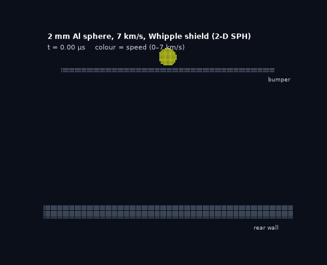 | **Hypervelocity impact.** An SPH hydrocode, planar or axisymmetric, with Mie–Grüneisen or Tillotson equations of state, von Mises strength, Monaghan artificial stress and Benz–Asphaug (Grady–Kipp) fracture, and Whipple-shield ballistic limit equations. Shock pressure matches the exact Hugoniot to 1.3 %; at 3 and 5 km/s the simulated shield fails within one diameter step of NASA's empirical ballistic limit. |
| 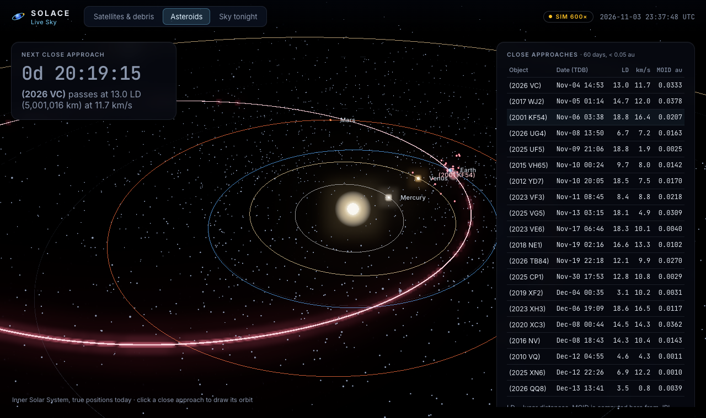 | **Near-Earth asteroids.** A three.js view of the inner Solar System with 2,548 potentially hazardous asteroids at today's positions, upcoming close approaches with their orbits, and MOID computed here (median difference from JPL: 1.2e-4 au). |

- **Live Sky** web app (three.js): the features above, plus conjunction alerts for protected assets and orbit and ground tracks.
- **Catalog**: the full public catalog (~33k objects, ~12k debris and rocket bodies) via COMSPOC Spacebook, with CelesTrak as the fallback.
- **Conjunctions**: batch SGP4 over the public catalog → time of closest approach (TCA), miss distance, collision probability (2-D Foster Pc), with realistic Spacebook covariances.
- **Risk**: an orbital-shell graph, an SGP4 physics baseline, a spatio-temporal GNN forecaster, and a per-asset penetration-risk index.

Earth and sky textures are credited in [web/textures/CREDITS.txt](web/textures/CREDITS.txt).

See [PLAN.md](PLAN.md) for the design, data sources and research plan. Figures are rebuilt with
`scripts/make_figures.py`, and app captures with `scripts/capture_app.py`.

## Install

```bash
python3 -m venv .venv
.venv/bin/pip install -e ".[dev,ml,live]"
```

## Use

```bash
.venv/bin/solace screen NISAR --days 3
.venv/bin/solace risk NISAR --days 365 --area 100
.venv/bin/solace impact --speed 7 --sph --html reports/whipple_7kms.html
.venv/bin/solace validate
.venv/bin/solace serve
```

`serve` starts the Live Sky app at http://127.0.0.1:8000.

A full walkthrough with figures is in [notebooks/walkthrough.ipynb](notebooks/walkthrough.ipynb). It covers screening NISAR, assumed vs Spacebook covariance, ballistic-limit curves, an SPH impact, the shell grid, asset exposure, and MOID vs JPL. Rebuild it with `.venv/bin/python notebooks/build_walkthrough.py`.

## Deploy the Live Sky demo

```bash
docker build -t solace .
docker run -p 8000:8000 solace
```

To host it, push the repo to GitHub, then in Render go to New → Blueprint and select the repo; it reads [render.yaml](render.yaml). Measured in Docker with the full catalog, the server uses about 430 MiB (399 MiB peak during startup). That fits the free 512 MB plan with little headroom, so use the Starter plan if Render restarts it for memory. Free instances sleep when idle, and the first visit afterwards takes several minutes while the catalog reloads and the protected assets are re-screened.

## Development

```bash
.venv/bin/ruff check src tests
.venv/bin/pytest -q
```

CI ([.github/workflows/ci.yml](.github/workflows/ci.yml)) runs lint and the offline unit tests on Python 3.10–3.12.

Training the forecaster uses historical catalog snapshots. By default they come from COMSPOC Spacebook, which needs no account (about 1.6 GB for weekly snapshots 2016–2026):

```bash
.venv/bin/solace history --start 2016-01-04 --end 2026-10-26 --step 7
.venv/bin/python scripts/run_phase3.py --seeds 2 --epochs 150
```

Space-Track (`--source spacetrack`, with `SPACETRACK_USER` / `SPACETRACK_PASS` set) is optional.

## Validation so far

| Check | Result |
|---|---|
| Pc vs closed-form (isotropic, noncentral χ²) | matches to 1e-4 relative |
| Screening vs CelesTrak SOCRATES (100 events) | 81 reproduced; TCA within 0.9 s median; relative speed within 0.4 m/s; range differs by a median of 5 km. SOCRATES used TLEs 14–45 h older, so this is TLE-update error, not engine error |
| SPH vs exact shock Hugoniot (Al on Al, 1–4 km/s) | shock pressure within 1.3 %, particle velocity exact |
| SPH vs BLE (`scripts/sph_ballistic_limit.py --axisymmetric`, 0.05 mm particles, full physics) | 0.5/1.5 mm Al Whipple shield at 15 mm standoff, failure = material through the rear wall or detached spall (Christiansen's criterion). 3 km/s: holds at 1.2 mm, fails at 1.5 mm (BLE 1.17 mm). 5 km/s: holds 1.2, fails 1.5 (BLE 1.56). 7 km/s: holds 1.2, fails 1.5 (BLE 1.95), ~1.4× conservative. Without fracture the threshold is the same at 0.1, 0.07 and 0.05 mm; with full physics it rises one step (fails at 1.2 → 1.5 mm at 7 km/s) from 0.1 to 0.05 mm, so it is not fully converged. Doubling the spall strength to 2 GPa changes nothing |
| Debris cloud half-angle (SPH) | 38–48°, around the 30–45° seen experimentally |
| Kinetic-gas conjunction rate vs SGP4 screening (`scripts/validate_kinetic.py --weeks 7`, 1 day from each of 7 weekly snapshots, 100 objects each) | non-constellation objects 0.85–1.01× at 1–10 km; Starlink same-constellation weight 0.12 [0.10, 0.15] below 2 km |
| MOID vs JPL SBDB (60 PHAs) | median difference 1.2e-4 au, max 8.8e-4 au |
| Spacebook ephemeris vs our SGP4 (NISAR) | 43 m at epoch, so its covariance describes exactly the propagation we use |
| Assumed vs Spacebook covariance (455 events, 6 assets) | Spearman 0.43; 38 alert-tier changes; events above 1e-6 fall from 32 to 10; Starlink Pc systematically higher (manoeuvre-driven TLE error), debris mixed |

## Known limitations

- TLEs carry no covariance. Pc uses COMSPOC Spacebook synthetic covariance where available, and assumed RIC sigmas otherwise. Each event records which source it used.
- The SPH solver now has strength, Tillotson EOS, artificial stress and Weibull-flaw fracture, but it is axisymmetric (normal impacts only), erodes particles that run away, and at 7 km/s it still fails ~1.4× below the empirical limit, likely because melting and vaporisation of the projectile, which spread its momentum over a wider cloud, are not modelled (Tillotson has no latent heat). Use it for cloud shape, timing and trends, and the ballistic limit equations for pass/fail.
- The kinetic-gas conjunction rate assumes random motion. Checked against SGP4 screening on 7 weekly snapshots (fresh TLEs each week; one long screening is invalid because Starlink positions drift kilometres in a few days), it is within 0.85–1.01× for non-constellation objects at 1–10 km, but 6–7× too high for Starlink below 2 km, because 70–80 % of their close approaches are with other Starlinks flying coordinated orbits. Same-constellation pairs are weighted 0.12 [0.10, 0.15] (measured below 2 km; it rises to 0.4–0.5 at 5–10 km, where neighbouring slots pass). OneWeb had only 2 same-constellation approaches below 2 km, so its weight is not measured there.
- The small-debris power-law slopes in the risk index cannot be calibrated without ORDEM or MASTER output (ORDEM 3.1 publishes its size distributions only as figures). The risk report therefore carries a penetration-probability band over slopes 1.0–1.71 above 1 cm (NASA Standard Breakup Model and drag-flattened populations) and 1.6–2.6 below, instead of a single number.
- On 2016–2026 history the GNN ties a hybrid physics forecast of 28-day total shell populations. On debris-cohort decay it beats SGP4 physics by 11–14 % at 3 and 6 months, but space-weather inputs add nothing at any target tried, and its re-entry counts are far worse than physics (see PLAN §7).
- Per-object re-entry (Phase 3c): physics with fitted ballistic coefficients, Sun/Moon perturbations and a solar-cycle analog forecast reaches an 18 % median 1-year timing error over 2016–2026 (persistence 22 %, SGP4 200 %; 12 % given the true future space weather). Calibrated 80 % windows cover 77 % over the decade but only 56 % in 2025, after the Cycle 25 maximum. Learned residuals don't generalise across the solar cycle. Correcting NRLMSIS with CHAMP, GRACE, GRACE-FO and Swarm densities cuts the true-weather re-entry count error by ~20 % but leaves forecast timing unchanged (PHYSICS §9). NASA MSFC's archived flux forecasts fix the 2025 miss (31 % → 20 %) and, with the density correction, keep 80 % windows calibrated in every year (worst 73 %), but no realistic forecast beats ~17–20 % median against 12 % with the true weather (PHYSICS §10). Ablations change the 1-year error by at most ~1 point: NRLMSISE-00 instead of NRLMSIS 2.1 makes no difference (the drag fit absorbs the model's bias), only a short 14–40 day drag-fit window is measurably worse, and the MSFC anchoring choice moves it by under a point (a 6-month fade is slightly better than our 1-year default; no anchoring is 1.5 points worse) (`scripts/analyze_ablations.py`). Theory and choices are in [docs/PHYSICS.md](docs/PHYSICS.md).
- Payloads (`scripts/run_payloads.py`): screening out any satellite whose semi-major axis rose by more than 0.1 km in the previous 120 days (debris never exceeds 0.06 km), coasting payloads are forecast as well as debris: 17.9 % median 1-year error with MSFC, 12.2 % with the true weather, over 13,807 payloads. 6.6 % of payload re-entries follow a later manoeuvre, and for 79 % of these the forecast was no re-entry: deliberate de-orbits, not drag. 80 % windows cover only 70 % for payloads.
